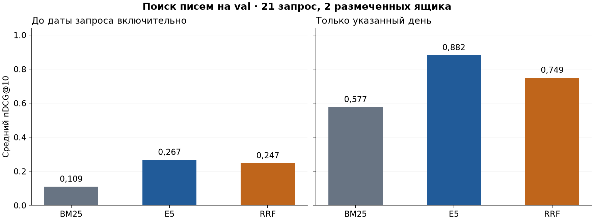
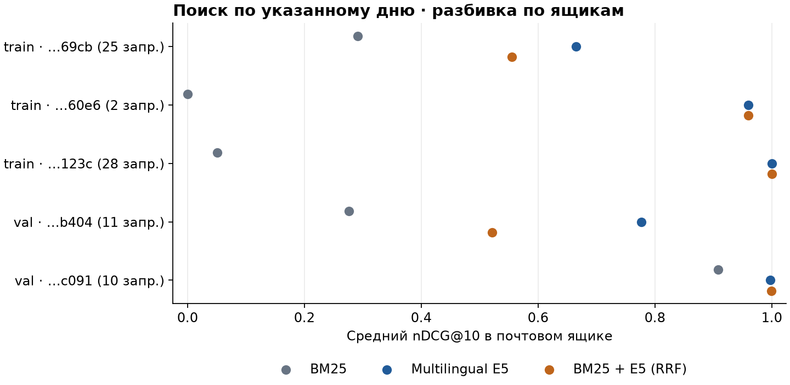

# Графики

## Средний nDCG@10 на val

По вертикали среднее по 21 запросу из двух размеченных ящиков. Слева доступны все письма до даты запроса, справа выдача ограничена днём из текста. Фильтр повышает среднее у всех трёх вариантов. E5 лидирует по nDCG@10 в обоих режимах. Для BM25 при смене списка кандидатов также пересчитываются статистики индекса.

## nDCG@10 по почтовым ящикам

Каждая точка усредняет запросы соответствующего ящика. Число запросов указано в подписи ряда. У двух val-ящиков заметно разная сила BM25. RRF уступает E5 в одном val-ящике и примерно совпадает с ним в другом. На обоих графиках показаны наблюдаемые значения без интервалов.
