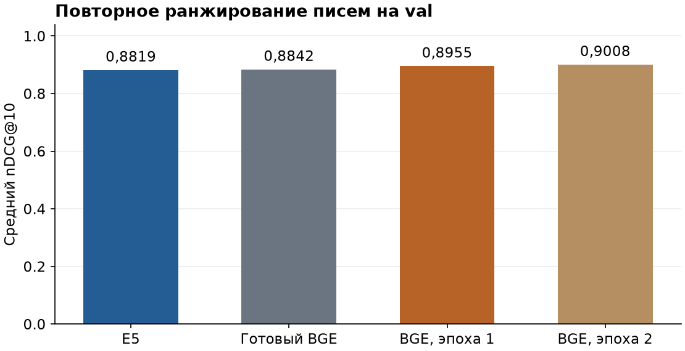
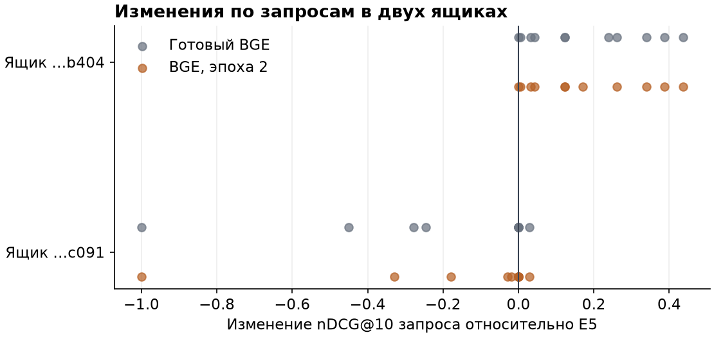

# Графики reranker

## Средний nDCG@10 на val

Среднее по 21 запросу в двух размеченных ящиках. Каждый вариант получает одинаковый top-20 E5. График показывает эффект изменения порядка кандидатов и позволяет отделить эффект готового BGE от эффекта обучения на почтовых парах.

## Парные изменения по запросам

Точка — разность nDCG@10 для одного запроса относительно E5. Результаты готового BGE и лучшей из двух обученных эпох показаны отдельно для каждого ящика. Совпадающие точки расположены поверх друг друга. График показывает, повторяется ли направление изменения на разных запросах и в обоих ящиках. Интервалы не показаны. Точные счётчики лежат в приложении.
