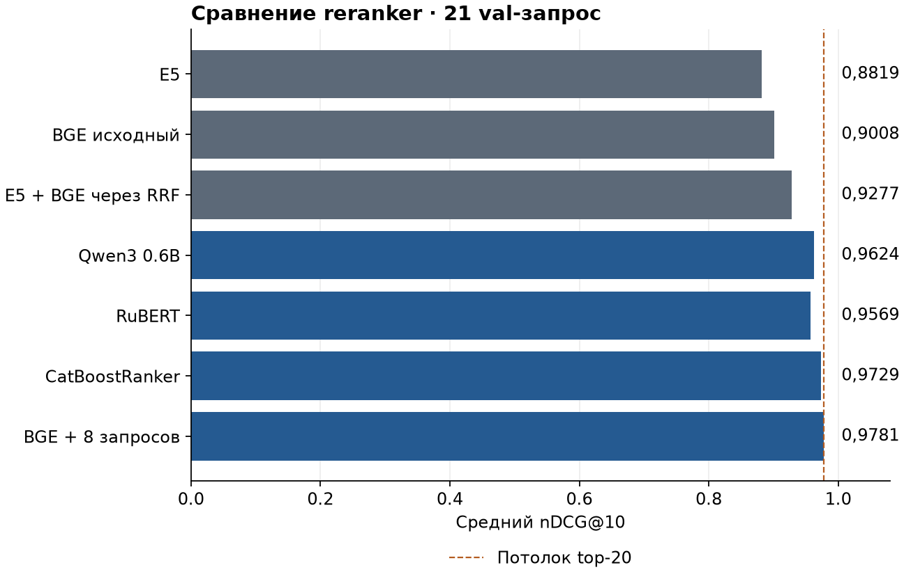
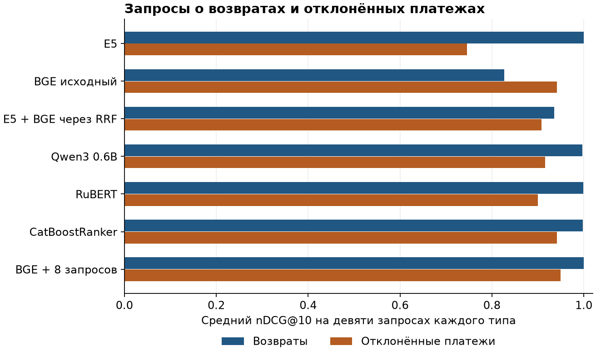

# Графики сравнения reranker

## Среднее качество на val

По одному столбцу на вариант. Среднее по 21 val-запросу из двух ящиков. Пунктир показывает oracle для уже отобранного top-20. График показывает, сколько запаса для перестановки оставляет каждый метод на этих кандидатах.

## Возвраты и отклонённые платежи

В каждом разрезе девять запросов. Проверяем, сохраняет ли метод сильные результаты E5 по возвратам, пока улучшает результаты на отклонённых платежах. Точечные значения без интервалов.

[Полные разрезы](stats-appendix.md)
